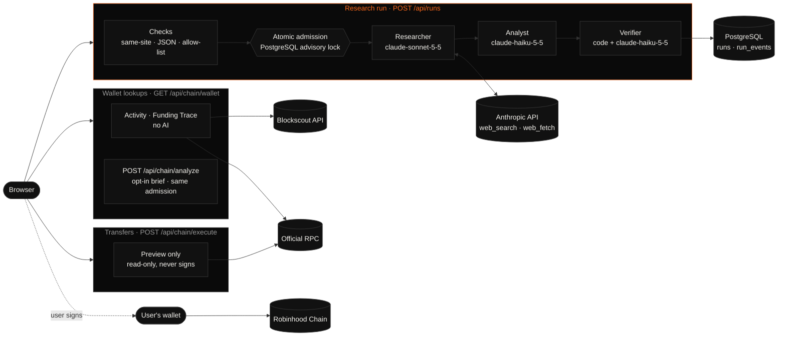

# Architecture

SYNCRONIX is a single Next.js application backed by PostgreSQL. The research itself is done by a
Claude model using Anthropic-hosted server tools (`web_search`, `web_fetch`), so the SYNCRONIX server never fetches
arbitrary URLs itself.

Three request paths share one application. Only research runs and the opt-in wallet brief call a model, and both go
through the same atomic admission.

The SYNCRONIX server never signs or broadcasts a transaction: its RPC client allows read methods only, and transfers
are signed in the user's own wallet ([wallet-transfers.md](wallet-transfers.md)).

## Components

| Component | Responsibility |
|---|---|
| Console UI | Task input, live progress (plan → research → analyze → deliver), report rendering (no raw HTML, http(s) links only), private history, limit notices |
| Runs API | Starts runs and streams events; lists and opens the visitor's own runs; reports the visitor's quota |
| Admission | One PostgreSQL transaction under an advisory lock decides whether a run may start and records its cost reserve |
| Agent loop (Researcher) | Calls the model with the research protocol, streams tool use and text, enforces the read gate and cost ceiling, verifies sources |
| Analyst and Verifier | Analyst extracts checkable claims with verbatim quotes; Verifier matches quotes against fetched page text, cross-checks facts across independent domains and judges support from the evidence only |
| Chain reads | Read-only Robinhood Chain RPC (official endpoints, method allowlist, chain ID checked); results added as research evidence |
| Indexer client | Read-only Blockscout API client: fixed path allowlist, validated parameters, per-lookup call budgets, daily allowance, pacing, in-memory cache; the API key is added server-side only |
| Wallet Intelligence | Activity and funding trace computed in code from indexed data, cross-checked against the RPC; graph with verified and inferred edges ([details](wallet-intelligence.md)) |
| Wallet AI analysis | Opt-in only: a deterministic fact sheet, one `claude-haiku-5-5` call, links and addresses not in the fact sheet removed in code |
| Transfer preview | Parses and validates one native ETH transfer, reads balance, gas and recipient from the official RPC, returns a 60-second preview; holds no keys and cannot send |
| Accounting | Records token usage split (uncached, cache read, cache write, output), searches and estimated cost per run |

## Request flow of a run

1. The browser posts a task. The server validates it and checks the request comes from the site itself.
2. If the same browser asked the identical task within the last hour, the saved run is replayed at no cost.
3. Admission reserves the run's cost ceiling ($0.20) from the daily budget, atomically with the concurrency and
   per-visitor checks. A refused run gets a clear reason and the reset time.
4. The Researcher researches and streams events; the Analyst then extracts up to 8 claims with verbatim quotes and the
   Verifier checks them (quote matching and cross-domain checks in code, then a verdict from that evidence only).
   When the run finishes, its real cost replaces its reserve in the same database statement.
5. A run cut off by a crash keeps its full reserve as its cost, so the daily budget errs on the safe side.

## Data model

`runs` holds one row per run: task, status, report, sources (with verified/read flags), token usage, searches, pages
read, estimated cost, duration, a hash of the browser's owner token and a keyed hash of the visitor's network.
`run_events` holds the progress events used to replay a run in the console. AI wallet analyses are stored as runs too,
so they share the same budget accounting and private history. Wallet lookups themselves are not stored; they are
cached in memory for minutes.

## Deployment shape

One Node.js process bound to localhost behind nginx (TLS, HSTS, request rate limiting, SSE without buffering),
managed by systemd, with a daily PostgreSQL backup timer. Releases are immutable folders; switching or rolling back
is a symlink change and a service restart.
