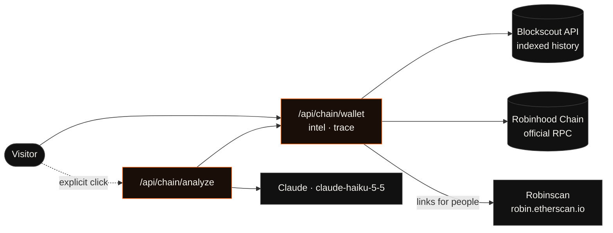

# Wallet Intelligence and Funding Trace

Type a Robinhood Chain address into the **Address lookup** on the [platform page](https://syncronixai.xyz/platform)
and SYNCRONIX shows three tabs:

| Tab | What it shows | Model calls |
|---|---|---|
| **Activity** | Recent transactions, ETH inflows and outflows (top-level and internal), fees, contract interactions, largest counterparties, token transfers | None |
| **Funding trace** | First funder, funding timeline, upstream path up to 5 hops, shared funder, comparison with up to 2 other addresses, interactive graph | None |
| **Analyze with AI** | A cost estimate first; a written brief only after you click the button | One, only on click |

Activity, funding traces and graphs are **deterministic**: computed in code from indexed chain data and the chain's
official RPC. No AI is involved in producing them. Everything is read-only; SYNCRONIX holds no keys and sends no
transactions.

## Data sources

| Source | Used for |
|---|---|
| **Blockscout API** (mainnet chain 4663 through Blockscout's hosted API with a server-side key; testnet 46630 through the public testnet explorer API) | Transactions, internal ETH transfers, token transfers |
| **Official Robinhood Chain RPC** (read-only method allowlist, chain ID checked) | Balance, nonce, contract code; independent check of indexed transactions |
| **Robinscan** (`robin.etherscan.io`) on mainnet, the testnet explorer on testnet | Every link shown to people. Links only: no data is read from them |

The indexer key never leaves the server. The server only calls a fixed allowlist of indexer paths
(`/addresses/{a}`, its transactions, internal transactions and token transfers, `/transactions/{h}` and its
internal transactions) with validated query parameters.

## Activity

- Reads the address's **150 most recent transactions** (3 pages), **100 most recent internal ETH transfers**
  (2 pages) and the latest page of token transfers.
- Sums ETH in and out, split into top-level and internal, plus fees and failed transactions.
- Groups contract calls by contract and method, and ranks counterparties by ETH moved.
- **RPC cross-check:** the newest transaction is re-read from the official RPC and its sender, recipient and value
  must match.
- A **coverage** line states exactly what was read: number of transactions and whether that is the complete
  history or only the most recent part, and the time span covered.

## Funding trace

### First funder

The *first funder* is whoever sent the address its **first ETH**. SYNCRONIX determines it as follows:

1. Find the earliest block in which the address either sent a transaction or received a top-level ETH transfer.
2. Read every **internal** ETH transfer to the address up to that block, oldest first.
3. The earliest inflow of either kind is the first funder. Inflows from the same sender in the same block are merged,
   and internal transfers within one transaction are summed, so a tiny first deposit is not mistaken for zero.
4. A top-level transfer is re-read from the official RPC: sender, recipient and value must match (`rpc`). An internal
   transfer is confirmed by checking that its transaction exists and succeeded on the RPC (`indexer+rpc_tx`).
5. The result is marked **proven** only when the indexer reported the internal-transfer history up to that block as
   complete. Otherwise it is shown as **earliest found** with a note that an earlier inflow may exist.

Bridge deposits from Ethereum (Arbitrum system transaction types ≥ 100) are labelled as bridge deposits, and the
Ethereum (L1) sender is computed by undoing Arbitrum's address aliasing.

### Upstream path

The same procedure is repeated on the funder, then on its funder, up to **5 hops**. Every trace ends with a stated
reason:

| Stop | Meaning |
|---|---|
| `max_hops` | 5 hops traced, the maximum |
| `contract` | Funded by a contract (internal transfer). Contracts move ETH on behalf of whoever called them; the calling transaction is linked |
| `bridge` | Funded by a deposit bridged from Ethereum; the trace stops at the bridge |
| `system` | Funded by a chain system address |
| `cycle` | The path loops back to an address already traced |
| `never_funded` / `not_found` / `no_history` / `unattributed` | No inflow, none found in the indexed history, no indexed history, or a balance increase that could not be tied to a transfer |
| `budget` | Stopped to stay within the lookup's limit of indexer calls |

### Shared funder and comparison (inferred)

- **Shared funder:** SYNCRONIX reads the first funder's **50 most recent outgoing transactions** and lists the other
  wallets it paid. When it paid **20 or more distinct wallets**, it is marked as a likely distribution service, and
  sharing it is weak evidence of anything.
- **Compare:** up to **2** more addresses are traced the same way. Funders that appear in both paths are reported as
  shared upstream funders, with their hop distance from each address.

### Verified versus inferred

| | Verified | Inferred |
|---|---|---|
| What it is | An actual on-chain ETH transfer | A pattern across transfers |
| Examples | First funder, each hop of the upstream path, transfers from the first funder to other wallets | "These wallets share a funder", "these two addresses share an upstream funder" |
| Evidence | Transaction link; `rpc`, `indexer+rpc_tx` or `indexer` | The verified transfers it is built from |
| In the graph | Solid edge, labelled *verified* | Dashed edge, labelled *inferred* |
| Proves common ownership? | No | No |

SYNCRONIX never says who owns or operates an address. An explorer name tag, when present, is shown as a tag set by
the explorer, not as an identification.

## Analyze with AI (opt-in)

1. Opening the tab requests a **cost estimate** (`GET /api/chain/analyze`). This makes no model call. It shows the
   model, estimated input tokens, the estimated cost, the maximum possible cost, and your remaining runs today.
2. Only clicking **Analyze with AI** sends `POST /api/chain/analyze`. Nothing in SYNCRONIX sends it automatically.
3. The server builds a **fact sheet** in code from the same Activity and Funding-trace data, and makes one call to
   `claude-haiku-5-5` (adaptive thinking at low effort, at most 3,000 output tokens, 60-second timeout).
4. The model may use only the fact sheet and must cite its explorer links. Afterwards the answer is **checked in code**:
   any link or address that is not in the fact sheet is removed before it is shown or saved.

| Budget control | Value |
|---|---|
| Counts toward | Your daily run (the same 1 per day as research runs) and the shared $0.50 daily budget |
| Reserve held while running | Twice the maximum estimate, at least $0.005 and at most $0.20 |
| Runs in progress across the service | 1 (shared with research runs) |
| Same browser, same address, unchanged data within 60 minutes | Saved brief replayed at $0 |
| Empty or cut-off answer | Recorded as failed with its real cost; nothing partial is shown |

Measured on production data: estimates of **$0.00114–$0.00124** (maximum $0.00202–$0.00215) for the five addresses in
the [benchmark](https://github.com/SyncronixLabs/syncronix-benchmarks), and $0.00135 with one compared address; two real analyses during release testing cost
**$0.0013** and **$0.0014** and took 6–7 seconds.

## Limits and caching

| Limit | Value |
|---|---|
| Chain lookups per visitor network | 30 per minute (shared by all chain endpoints) |
| Funding traces per visitor network | 6 per minute |
| Funding traces running across the service | 3 at once |
| Indexer calls per lookup | Activity 10 · trace 80, plus 45 per compared address |
| Indexed reads per day (mainnet) | About 3,000 calls; reads also stop early if the indexer's remaining daily credits run low, and resume the next day |

| Cached for | |
|---|---|
| Activity | 60 seconds |
| Funding trace | 5 minutes |
| A first funder | 10 minutes, or 24 hours once proven |
| A transaction | 1 hour |

When a limit applies, the response says which one and when to retry; the RPC lookup itself keeps working.

## Known limitations

- **Pending internal transactions on mainnet.** Blockscout currently reports that some internal transactions on
  Robinhood Chain mainnet are still being processed. While it does, mainnet first funders are shown as
  *earliest found*, not *proven*. They become *proven* automatically once the indexer reports complete data.
- **Partial history for busy addresses.** Activity covers the most recent 150 transactions and 100 internal
  transfers; the coverage line says so.
- **Contracts end a trace.** A contract that pays out ETH does so on behalf of its caller; SYNCRONIX links the calling
  transaction but does not guess whose money it was.
- **ETH only.** Funding traces follow ETH, not tokens.
- **Indexer dependence.** Indexed data comes from a third party. Each lookup cross-checks against the official RPC,
  and the page says so when the indexer is unavailable.
- **Patterns are not identities.** Shared funders are inferred and are never presented as proof of common
  ownership.
