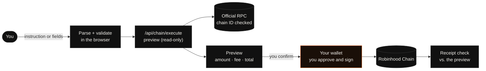

# Wallet transfers (Execution v1)

One native ETH transfer at a time on Robinhood Chain, **started and approved by you** in the Robinhood Chain panel on
the [platform page](https://syncronixai.xyz/platform). Live on mainnet (chain 4663) and testnet (46630).

This is **not** autonomous AI execution. No agent decides, plans or sends anything; the instruction is read by fixed
rules, not a model. SYNCRONIX holds no keys and never signs: your own wallet (MetaMask or another EIP-1193 wallet)
signs, after you approve it there. Autonomous AI execution remains [planned](roadmap.md).

## Flow

| Step | What happens |
|---|---|
| 1. Instruction | `Send 0.01 ETH to 0x…`, `Transfer 0.5 eth to 0x… on testnet` or `Pay 0x… 0.01 ETH`, or a recipient and amount typed into separate fields |
| 2. Checks | Address format and [EIP-55](https://eips.ethereum.org/EIPS/eip-55) checksum, exact amount (up to 18 decimals), per-transfer cap, network enabled, sender ≠ recipient; contract recipients refused on mainnet |
| 3. Preview | The server reads the official RPC: live balance, `eth_estimateGas` (includes the L1 data cost), gas price, recipient code and history. Shows the fee, the most it can cost, the total and your balance afterwards. Valid 60 s |
| 4. Confirm | On mainnet you tick that this moves real ETH, then press **Confirm in wallet**. The page re-checks the account and chain and sends exactly the previewed values to the wallet |
| 5. Receipt | The page follows the transaction until it is in a block, then checks it against the preview: sender, recipient, amount, chain, plain ETH transfer |

Refused before anything reaches the server: swaps, tokens, approvals, `all` / `max` / percentages, scheduled or
conditional transfers, `.eth` names, several recipients, a mismatched checksum.

## Limits

| | Mainnet (4663) | Testnet (46630) |
|---|---|---|
| Per transfer | 0.05 ETH | 1 ETH |
| Contract recipients | Refused | Allowed, with a warning |
| Never-used recipient | Warning | Warning |
| Gas limit sent to the wallet | Estimate + 20 % | Estimate + 20 % |
| Fee cap | 2 × the current gas price, no priority tip | Same |
| Preview validity | 60 s, then refreshed before anything can be sent | Same |

Previews count toward the 30 chain lookups per minute per visitor. The preview endpoint is same-site only.

## Safety properties

- No server-side keys; the server never signs or broadcasts. The RPC client allows read methods only.
- One wallet request per **Confirm** click; repeated clicks while a request is open are ignored.
- A preview is discarded when the wallet's account or network changes; an expired one is refreshed and shown again.
- The wallet must report the previewed chain (4663 or 46630) before anything is sent.
- Wallet errors (rejected, insufficient funds, pending request, wrong network) are shown in plain words; none of
  them sends anything.
- Mainnet needs two separate server settings to be switched on; with either missing it is refused.

Transfers on Robinhood Chain are final. SYNCRONIX cannot reverse, cancel or refund them.

## Verification

- **Mainnet (live):** a real wallet-approved transfer through production was checked on the official RPC: success on
  chain 4663, a plain ETH transfer to a regular account within the cap, and the exact gas limit, fee cap and zero
  tip from its preview, so it was sent as previewed. A person started, checked and signed it; no AI was involved.
- **Testnet:** a real wallet-approved transfer, checked the same way on chain 46630.
- Automated, without broadcasting: parser and checksum vectors, the mainnet configuration matrix, caps, contract and
  chain-ID refusals, and the browser flow with a mock wallet against the real mainnet and testnet RPC (preview,
  acknowledgement, wrong chain, wallet errors, double clicks, receipt comparison).
