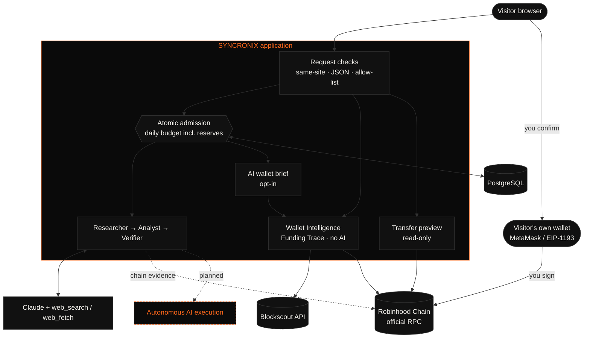
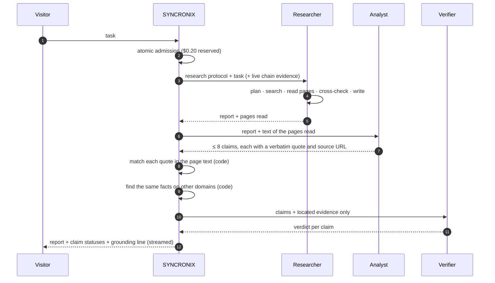
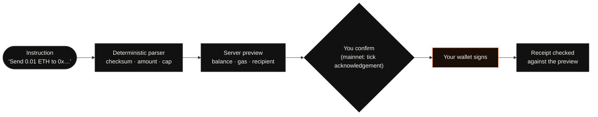

# SYNCRONIX Technical Whitepaper

**Version 1.0 · November 2026.** Describes the production system at [syncronixai.xyz](https://syncronixai.xyz) as
deployed on 20 November 2026 (application release `926b089`). Every number is measured or configured, and its source
is linked. What is planned is labelled *planned* and is not described as working.

> SYNCRONIX is an independent project and is not affiliated with, endorsed by or partnered with Robinhood Markets,
> Inc. or its affiliates. This paper describes software only. It makes no claims about tokens, audits, partnerships
> or team members.

## Contents

1. [Abstract](#1-abstract)
2. [Problem](#2-problem)
3. [Design principles](#3-design-principles)
4. [System overview](#4-system-overview)
5. [Verified research](#5-verified-research)
6. [Admission and cost control](#6-admission-and-cost-control)
7. [Robinhood Chain data and Wallet Intelligence](#7-robinhood-chain-data-and-wallet-intelligence)
8. [Wallet-approved transfers (Execution v1)](#8-wallet-approved-transfers-execution-v1)
9. [Security and privacy](#9-security-and-privacy)
10. [Evaluation](#10-evaluation)
11. [Limitations](#11-limitations)
12. [Planned: autonomous AI execution](#12-planned-autonomous-ai-execution)
13. [References](#13-references)

## 1. Abstract

SYNCRONIX is a public, free service with three live parts:

- **Verified research.** A team of three agents researches a question on the web, then checks the result: a
  Researcher, an Analyst and a Verifier.
- **Wallet Intelligence and Funding Trace.** Read-only analysis of any Robinhood Chain address, computed in code
  without AI.
- **Wallet-approved transfers.** One native ETH transfer at a time, parsed by fixed rules, previewed by the server
  and signed only in the user's own wallet.

The system rests on four mechanisms:

- each key claim in a report is tied to a verbatim quote from a page that was actually read, and the quote is
  matched in code;
- every paid model call is admitted atomically against a hard daily budget;
- verified on-chain facts are kept apart from inferred patterns;
- SYNCRONIX holds no private keys.

Autonomous AI execution, where agents would plan and carry out on-chain actions themselves, is **planned** and is
not live.

## 2. Problem

Three failure modes motivate the design:

1. **Unread sources.** A web research agent can produce a report with a convincing source list while having read
   none of the pages. The first production run of SYNCRONIX did exactly that: it read 0 pages and listed 7
   sources ([note](https://github.com/SyncronixLabs/syncronix-research/blob/main/notes/2026-11-grounded-web-research.md)).
2. **Unbounded spend.** A free, public agent that calls paid models can be driven past any budget by simultaneous
   requests unless admission is atomic
   ([note](https://github.com/SyncronixLabs/syncronix-research/blob/main/notes/2026-11-atomic-budget-admission.md)).
3. **Overstated on-chain claims.** Wallet tools often present "these wallets share a funder" as if it were
   ownership, and present an earliest transfer the indexer happens to know about as the proven first funder
   ([note](https://github.com/SyncronixLabs/syncronix-research/blob/main/notes/2026-11-wallet-funding-trace.md)).

## 3. Design principles

| Principle | Consequence in the system |
|---|---|
| Read, then claim | Reports cite pages that were fetched and read; a read gate asks for more reading when fewer than two pages were read |
| Check in code where possible | Quote matching, link tracing, address checksums, receipt comparison and fact-sheet filtering are deterministic code, not model judgment |
| Verified ≠ inferred | A transfer with a transaction link is *verified*; a pattern such as a shared funder is *inferred* and labelled so |
| Hard budgets | Every paid call reserves its maximum cost first; the daily budget cannot be exceeded under concurrency |
| AI only when asked | Wallet data never calls a model; the optional AI wallet brief runs only on an explicit click, after a cost estimate |
| No keys | The server holds no wallet keys and its RPC client allows read methods only; users sign in their own wallet |
| Live means production | A feature is called live only when it runs at syncronixai.xyz |

## 4. System overview

SYNCRONIX is one Next.js application backed by PostgreSQL, behind nginx on a single server. Research uses Claude models
with Anthropic-hosted `web_search` and `web_fetch`, so the SYNCRONIX server never fetches arbitrary URLs itself.
Chain data comes from the official Robinhood Chain RPC and the Blockscout API.

| Component | Live | Model |
|---|---|---|
| Researcher | Yes | `claude-sonnet-5-5` |
| Analyst, Verifier | Yes | `claude-haiku-5-5` |
| Wallet Intelligence, Funding Trace | Yes | none |
| AI wallet brief | Yes, opt-in | `claude-haiku-5-5` |
| Transfer preview | Yes | none |
| Autonomous AI execution | **Planned** | — |

## 5. Verified research

**Researcher.** The model follows a five-step protocol: plan, search, read, cross-check, write.

- *Search:* 2 to 4 focused queries, with at most 6 searches per run.
- *Read:* the most relevant pages, with at most 6 per run and about 12,000 tokens per page. When an official or
  primary source exists, at least one page read must be that source.
- *Cross-check:* claims that have only one source are marked *(single source)*.
- *Read gate:* if the model tries to finish after reading fewer than two pages, it is sent back to read once more.
  This happens only while the run is under half its cost ceiling.
- *Tool versions:* the direct-call `web_search_20250305` and `web_fetch_20250910`. In side-by-side runs, the newer
  dynamic-filtering versions re-issued identical calls and cost more.

When a task names Robinhood Chain, an address or a transaction, live reads from the official RPC are added as
evidence.

**Analyst.** The Analyst extracts at most 8 checkable claims from the report. Each claim comes with a quote copied
exactly from one of the pages that were read. URLs not in the evidence set are discarded.

**Verifier.** The Verifier is independent of the Analyst and works in two steps:

1. Code checks each claim:
   - it looks for the Analyst's quote in the stored page text;
   - it searches the other independent domains for sentences that state the same facts.
2. A separate model call judges each claim **only from that evidence**. The possible verdicts are supported,
   partial, unsupported or contradicted.

A claim is shown as **verified** only when its quote was found in the page **and** the verdict is *supported*.

**Source checks.** Every link in the report is traced to a real search result or fetched page, and untraceable links
are flagged. Each source is labelled *read* or *seen*. A grounding line summarises:

- pages read;
- findings that cite a page that was read;
- unsourced findings;
- single-source findings;
- cited passages.

## 6. Admission and cost control

Every paid call is admitted in one PostgreSQL transaction under an advisory lock. Admission checks the shared daily
budget including the reserves of runs in progress, one active run across the service, and one run per visitor per
day. An admitted run reserves its $0.20 ceiling, and part of it is held back for the Analyst and Verifier. When the
run ends, its real cost replaces the reserve in the same statement. A run cut off by a crash keeps its full reserve
as its cost.

| Limit | Value |
|---|---|
| Shared daily budget (model + search) | $0.50, resets 00:00 UTC |
| Ceiling per run | $0.20 |
| Runs in progress across the service | 1 |
| Runs per visitor (IPv4 address or IPv6 /64) | 1 per day |
| Identical repeat by the same browser within 60 min | replayed at $0 |

Concurrency tests against real PostgreSQL showed the following:

- 25 simultaneous requests for one slot admitted exactly 1.
- 12 requests with room for 2 reserves admitted exactly 2.
- 6 requests from one visitor admitted exactly 1.

## 7. Robinhood Chain data and Wallet Intelligence

All chain access is read-only. The RPC client allows only a fixed list of read methods and checks the endpoint's
chain ID before using any data: 4663 for mainnet, 46630 for testnet. Indexed history comes from the Blockscout API
through a server-side client with these limits:

- a fixed path allowlist;
- validated parameters;
- a call budget per lookup;
- a daily allowance.

The API key never reaches the browser.

**Activity** shows an address's transaction history, ETH inflows and outflows including internal transfers, contract
interactions and counterparties. The newest transaction is re-read from the official RPC as a cross-check.

**Funding Trace** follows ETH upstream for up to 5 hops:

- **First funder.** This is the earliest of the address's first top-level inflow and any internal transfer before it.
  It is marked **proven** only when the indexer's history up to that block is complete; otherwise it is the
  *earliest found*.
- **Stop reasons.** Each trace stops with a stated reason: `max_hops`, `contract`, `bridge`, `system`, `cycle`,
  `never_funded`, `not_found`, `no_history`, `unattributed` or `budget`.
- **Shared funders.** Other wallets paid by the same funder, and funders shared with up to 2 compared addresses, are
  **inferred** links. They are never presented as common ownership.

**AI wallet brief (opt-in).** The brief runs only after the visitor sees an estimated and maximum cost and clicks
*Analyze with AI*:

- One `claude-haiku-5-5` call is made over a fact sheet built in code.
- Links and addresses in the answer that are not in the fact sheet are removed before display.
- The brief is admitted like a research run and counts as the visitor's daily run.

This filtering is the only AI fact check on wallet briefs: the research Analyst and Verifier are not involved.

## 8. Wallet-approved transfers (Execution v1)

Execution v1 lets a person send one native ETH transfer on Robinhood Chain mainnet or testnet. No AI is involved, and
SYNCRONIX never signs.

- **Parsing.** Fixed sentence forms (`Send|Transfer 0.01 ETH to 0x… [on testnet]`, `Pay 0x… 0.01 ETH`), or separate
  recipient and amount fields. The parser refuses swaps, tokens,
  approvals, `all`/`max`/percentages, scheduled or conditional transfers, `.eth` names and multiple recipients.
- **Checks.** The parser checks the EIP-55 checksum and an exact amount of up to 18 decimals. It also enforces the
  per-transfer cap (0.05 ETH on mainnet, 1 ETH on testnet) and refuses a transfer to the sender's own address.
  Contract recipients are refused on mainnet.
- **Preview.** The server reads the live balance and the recipient's code and history from the official RPC, along
  with the gas price and `eth_estimateGas`. The estimate includes the L1 data cost. The preview sets:
  - gas limit: the estimate + 20 %;
  - fee cap: 2 × the gas price;
  - priority tip: 0;
  - validity: 60 seconds.
- **Confirmation.** One wallet request is made per click. The page re-checks the account and chain before sending.
  The preview is discarded when either one changes.
- **Receipt.** The page checks the receipt against the preview: sender, recipient, amount, chain and that it is a
  plain ETH transfer.
- **Gating.** Mainnet needs two separate server settings. Production currently reports `testnet: true`,
  `mainnet: true` at `GET /api/chain?config=1`.

A real wallet-approved transfer through production was checked on the official RPC. It succeeded on chain 4663, as a
plain ETH transfer to a regular account within the cap. Its gas limit, fee cap and zero tip were exactly the
preview's, so it was sent as previewed. A testnet transfer was verified the same way on chain 46630. Transaction
details are kept private.

## 9. Security and privacy

| Area | Control |
|---|---|
| Secrets | Server-side only; automated checks scan client bundles and API responses |
| Cross-site use | `POST` endpoints accept only the site's own origin (`Origin` / `Sec-Fetch-Site`); no CORS headers are sent, so other websites cannot call the API from a browser. Terminals and servers can. |
| Input | JSON only, field allow-lists, size limits, control / zero-width / bidi characters stripped, parameterised SQL |
| Prompt injection | Web content is declared untrusted; the research agents have no tools that act |
| Private history | Random httpOnly owner token, hashed at rest; other visitors' runs return 404 |
| Network identity | Only a keyed hash of the visitor's network is stored, never the raw IP address |
| Keys and signing | No wallet keys on the server; read-only RPC methods; every transfer signed in the user's wallet |
| Transport | HTTPS + HSTS, Content-Security-Policy, X-Frame-Options DENY, nginx rate limiting |
| Recovery | Daily database backups kept 14 days; immutable releases with one-step rollback |

Full model: [security.md](security.md).

## 10. Evaluation

All results below are small samples. They are reported as measured, with conditions, in
[syncronix-benchmarks](https://github.com/SyncronixLabs/syncronix-benchmarks).

**Research quality** was measured on 13 Nov 2026, before the Analyst and Verifier were added. It used two tasks with
a single run per configuration.

| Configuration | Pages read | Findings citing a read page | Repeated calls | Cost |
|---|---|---|---|---|
| Original prompt | 0 | — | 1 search | $0.082 |
| Protocol + dynamic-filtering tools | 2–3 | 5/5, 1/4 | searches and fetches | $0.085–$0.106 |
| Protocol + direct-call tools (production) | 2 | 6/8, 5/5 | none | $0.040–$0.069 |

**Wallet Intelligence** was measured on production on 19 Nov 2026 with 5 addresses and no AI calls.

| Measure | Result |
|---|---|
| Activity, first request / cached | 4.0–5.8 s / 0.40–0.67 s |
| Funding trace, uncached | 1.7–7.6 s, 4–5 hops |
| Newest transaction matches the official RPC | 5/5 |
| First funder proven | testnet 1/1 · mainnet 0/4 (indexer still processing internal transactions) |
| Explorer links on Robinscan / testnet explorer | 379/379 |
| AI wallet brief, measured cost | $0.0013–$0.0014 |

**Execution v1:**

- *Two real wallet-signed transfers*, one on mainnet and one on testnet, read back from the official RPC.
- *Automated tests that broadcast nothing:*
  - parser and checksum vectors;
  - the mainnet configuration matrix;
  - the browser flow with a mock wallet against the real RPC.
- *Public API conformance* on 21 Nov 2026: 30/30 documented refusals and same-site checks behaved as documented on
  production. A successful preview had a gas limit of estimate + 20 %, a fee cap of 2 × gas price and no tip, and it
  expired after 60 s ([benchmark](https://github.com/SyncronixLabs/syncronix-benchmarks#api-conformance)).

## 11. Limitations

- **Shared budget.** Someone controlling many networks can use up the shared daily budget. That locks research for
  everyone until 00:00 UTC, though spend never exceeds the budget.
- **Shared networks.** Visitors on one shared address share one daily run.
- **Evaluation size.** Research-quality figures come from two tasks before the Analyst and Verifier existed, so the
  direction is clear but the effect size is not.
- **Verifier scope.** The Verifier judges only from the evidence it is shown. A claim can be verified against a page
  that is itself wrong.
- **Indexer completeness.** Indexed wallet history depends on a third party. Mainnet internal transactions are
  currently reported as still processing, so mainnet first funders are usually *earliest found* rather than
  *proven*.
- **Execution scope.** Execution v1 covers native ETH only: no tokens and no contract calls. Transfers are final, and
  SYNCRONIX cannot reverse them.

## 12. Planned: autonomous AI execution

**Not live.** The goal is policy-bound execution of actions that agents plan and a person approves, on Robinhood
Chain:

- simulation before signing;
- a receipt for every action;
- the same rule as today that SYNCRONIX holds no keys.

None of this is implemented in production. The roadmap lists it under
[Planned](roadmap.md#planned), and this paper will be revised when any part ships.

## 13. References

| Topic | Document |
|---|---|
| Architecture and data model | [architecture.md](architecture.md) |
| Research agent | [research-agent.md](research-agent.md) |
| Wallet Intelligence | [wallet-intelligence.md](wallet-intelligence.md) |
| Wallet transfers | [wallet-transfers.md](wallet-transfers.md) |
| Public API | [api.md](api.md) |
| Limits and privacy | [limits.md](limits.md) |
| Security model | [security.md](security.md) |
| Engineering notes | [syncronix-research](https://github.com/SyncronixLabs/syncronix-research) |
| Measurements and harnesses | [syncronix-benchmarks](https://github.com/SyncronixLabs/syncronix-benchmarks) |
| Robinhood Chain RPC (mainnet / testnet) | `https://rpc.mainnet.chain.robinhood.com` · `https://rpc.testnet.chain.robinhood.com` |
| EIP-55 checksums | [eips.ethereum.org/EIPS/eip-55](https://eips.ethereum.org/EIPS/eip-55) |

Licensed under [CC BY 4.0](LICENSE).
